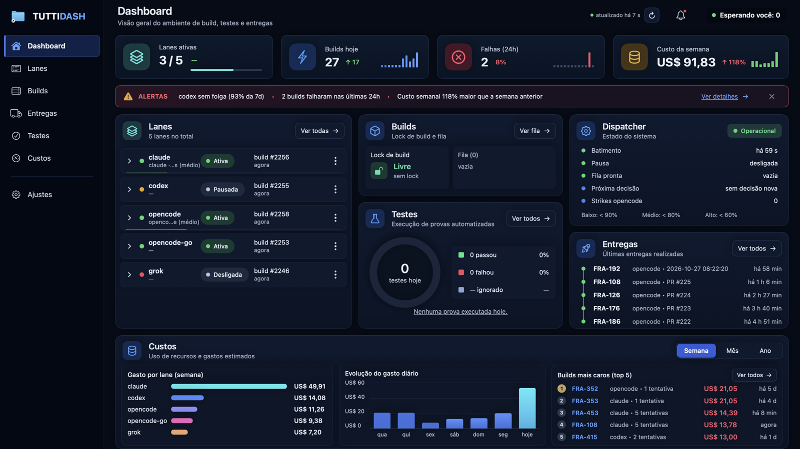

# TuttiDash by TranscentIA

Vários agentes de código trabalhando em paralelo num backlog do Linear, acompanhados pelo notch do Mac.



O TuttiDash é o conjunto de ferramentas locais que a TranscentIA usa para tocar um projeto do Linear
com agentes de código em **lanes** paralelas: um card, um worktree do git e um agente por lane de cada
vez. Ele é compartilhado como está, como exemplo que funciona. Foi feito para o Mac e o jeito de
trabalhar de um desenvolvedor, e isso aparece. [Read in English](README.md).

## O que tem aqui

| Parte | Onde | O que faz |
|---|---|---|
| Dispatcher | `lanes/dispatcher.py` | A cada 60 s pega um card pronto do projeto no Linear, cria o worktree, roda o agente sem interface no tmux (Claude Code, Codex, OpenCode, Grok CLI…), roda o comando de teste do projeto (a *prova*), faz o push, abre o PR com o `gh`, comenta e move o card para *In Review*. O agente não fala com o Linear nem com o GitHub. |
| Vigia | `bots/watch.py` | Revisa os PRs, faz o merge quando a prova está verde, faz a triagem das lanes paradas ou com falha e só chama o dono (etiqueta `needs:dono`) quando a mesma falha se repete. A IA só lê e devolve texto (`claude -p`, modelo local ou OpenCode); quem age é o script. |
| App do notch | `apps/notch-mac` | App SwiftUI/AppKit no notch e na barra de menus: lanes, builds, testes, entregas, custo tirado dos logs das lanes, limites de conta quando há fonte oficial, e os Ajustes. |
| CLI `gasto` | `gasto.py`, `gasto_lanes/` | Ledger de custo a partir dos logs das lanes, por dia, semana, card e lane. Veja [docs/gasto.md](docs/gasto.md). |
| Catálogo de agentes | `agents.d/*.json` | Um manifesto por agente (CLI, tipo de custo, modelos por esforço, comando de revisão). O Python e o Swift leem os mesmos arquivos. |

## Antes de usar

- **Só macOS** (14 ou mais novo). Projeto pessoal: há arestas. Issues são bem-vindas; não há promessa de suporte.
- **Ele roda agentes sozinho, com as suas contas.** Eles editam código, rodam comandos e gastam dinheiro ou cota.
  Teste primeiro num projeto descartável, deixe todas as lanes desligadas até o teste sem efeito
  (`--dry-run`) sair certo, e defina orçamentos (`lanes.budget_usd`) e caminhos protegidos (`protegidos`).
- **Limite de conta só de fonte oficial ou local**: a API de cobrança do GitHub Copilot e o banco local da
  sessão do OpenCode. As assinaturas do Claude Code, do Codex, do Grok e do Gemini não têm API pública
  oficial de cota, então o TuttiDash não mostra esses limites. O motor de leitura aceita outras fontes
  (`FonteUso`, veja `apps/notch-mac/README.md`).
- **Ele nunca renova nem regrava a credencial de outra ferramenta.** Lê logs, o próprio estado e a própria
  config. A chave da API do Linear fica no Keychain do macOS.

## Requisitos

- macOS 14+ e Xcode 16+ (toolchain do Swift)
- Python 3.9+ (só biblioteca padrão), git, o [GitHub CLI](https://cli.github.com) (`gh auth login`) e tmux
- Os CLIs dos agentes que você quer usar, já logados
- Um workspace do Linear e uma chave pessoal da API

## Começo rápido

```bash
git clone https://github.com/francieloliveira/tuttidash.git
cd tuttidash

# 1. Ferramentas em ~/.transcentia, ainda sem nada rodando em segundo plano
tools/install.sh --sem-launchd

# 2. Chave da API do Linear no Keychain (o comando pede a chave)
security add-generic-password -s linear-transcentia-lanes -a "$USER" -w

# 3. O app
cd apps/notch-mac && ./build.sh && open build/TuttiDash.app
```

Depois configure, no app (*Ajustes*) ou em `~/Library/Application Support/TuttiDash/config.json`
(partindo do [`config.example.json`](config.example.json)):

- **`projetos`**: o id do projeto no Linear, o repositório, a pasta dos worktrees, o comando da prova
  (`{suite}` vira a suíte que o agente pediu) e os caminhos protegidos. Cada projeto pode definir
  `suites` (suítes padrão quando a lane não especifica nenhuma) e `prova_tentativas`.
- **Linear**: estados *Todo*, *In Progress* e *In Review*; etiquetas `needs:dono` (ou a sua
  `linear.owner_label`), `lane:falhou` e `lane:parada`; um grupo de etiquetas `esforco` com `baixo`,
  `medio` e `alto`; e um grupo `lane` com uma etiqueta por agente (`claude`, `codex`…). Os ids são
  buscados pelo nome uma vez e guardados em `~/.transcentia/lanes/linear-ids.json`.

Veja o que o dispatcher faria, sem mexer em nada:

```bash
python3 ~/.transcentia/lanes/dispatcher.py --dry-run
```

O app agenda o dispatcher em modo real, mas ele só pega card para as lanes que você ligar em
*Ajustes › Lanes*. Quando o teste sem efeito sair certo, ligue uma lane e rode `tools/install.sh` de
novo, sem `--sem-launchd`, para registrar o vigia.

## Listas de modelos

Os Ajustes listam os modelos de cada lane pelos CLIs (`opencode models`, `grok models`), pela cache
que o Codex CLI guarda (`~/.codex/models_cache.json`) e pelas APIs oficiais quando há chave no ambiente
(`ANTHROPIC_API_KEY`, `OPENAI_API_KEY`). Sem lista, um modelo fixo digitado à mão continua valendo.

## Testes

```bash
python3 -m unittest discover -s tests -t .
python3 -m unittest lanes.test_lanes
cd apps/notch-mac && swift test
```

## Estrutura

```
agents.d/          um manifesto por agente
apps/notch-mac/    o app do Mac (biblioteca GastoCore + app NotchGasto)
bots/              vigia, prompts e modelos de launchd
docs/              referência do CLI gasto, dados de exemplo da foto
gasto_lanes/       Python: config, catálogo, projetos, ids do Linear, ledger de custo
lanes/             dispatcher, execução da lane, janela do tmux, prompts das lanes
tests/             testes Python e fixtures sintéticas
tools/             leitor da config, instalador, painéis, medida de uso, utilitários
```

## Sem vínculo

O TuttiDash é um projeto independente. Não tem vínculo, aval nem patrocínio da Anthropic, da OpenAI,
da xAI, do Cursor, do Google, do GitHub, do Linear nem do projeto OpenCode. Os nomes dos produtos
aparecem só para dizer com quais ferramentas ele funciona.

## Licença

[MIT](LICENSE). Veja [CONTRIBUTING.md](CONTRIBUTING.md) e [SECURITY.md](SECURITY.md).
